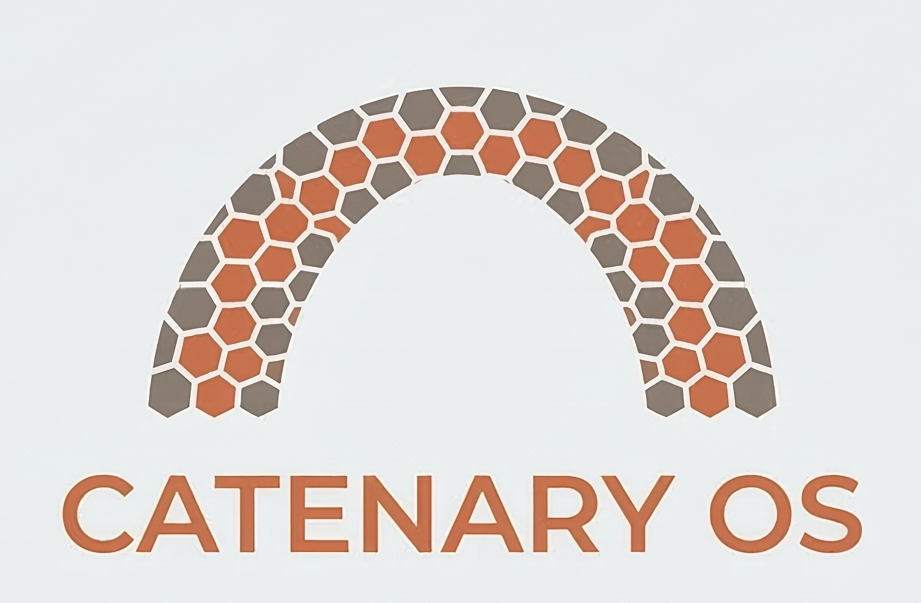

<p align="center">
  
</p>

<h1 align="center">CATENARY OS</h1>

<p align="center">
  <em>A distributed microkernel & bare-metal Type-1 hypervisor, written in Zig.</em>
</p>

<p align="center">
  
  
  
  
</p>

---

## What is Catenary OS?

A **catenary** is the curve a cable forms under its own weight. **Catenary OS** is an experimental operating system and Type-1 hypervisor that aims to run isolated MicroVMs and full VMs on a standalone node or across an IPv6-first cluster.

Catenary avoids a monolithic kernel and in-kernel POSIX compatibility. Linux MicroVMs are the intended environment for OCI workloads; full Linux distribution and Windows VMs, secure guest networking, clustered storage, and a common cluster UI are planned. The project is not yet a production platform or a claim of full OCI or guest-OS compatibility.

**Current limits:** the repository contains experimental Linux direct-boot, VMX/EPT, virtio, DIPC, NVMe, cluster-discovery, and native TUI paths. General UEFI-based full VMs, Windows support, complete VM microsegmentation, replay-protected encrypted cluster transport, and quorum-backed storage are not established end to end. Storage now fails without NVMe and sends NVMe Flush when a volatile cache is reported; FUA requests use a write-then-flush fallback. QEMU smoke results do not prove physical power-loss durability or native NVMe FUA behavior. See the [architecture overview](docs/architecture.md) and [test evidence](TEST_READY.md).

---

## Architecture

### The Exokernel (Ring 0)

The kernel is stripped to the absolute minimum. It handles only:

- **Physical Memory Allocation** — page frame management via Zig's explicit allocators
- **CPU Scheduling & Context Switching** — assembly-backed task management with TCBs
- **Hardware Virtualization (Intel VT-x)** — initializing and managing hypervisor VMX state
- **Local IPC** — asynchronous message-passing queues between processes

### User Space (Ring 3) Services

The target places drivers, complex device backends, networking, storage policy, orchestration, and user interfaces in isolated Ring-3 services communicating via DIPC. Existing guest-device handling still includes Ring-0-adjacent bring-up code. Current reserved service endpoints include:

| Daemon | Endpoint | Role & Responsibilities |
|--------|:--------:|-------------------------|
| **`netd`** | 1 | Physical Virtio-Net PCI driver, IPv6 NDP, embedded TCP stack, DIPC wire router |
| **`storaged`** | 4 | NVMe PCI controller and experimental block-I/O service |
| **`dashd`** | 5 | Telemetry aggregation and Varde shell command execution engine |
| **`containerd`** | 6 | Experimental OCI-oriented workflow and NVMe partition staging; full image unpack remains simulated |
| **`clusterd`** | 7 | Dynamic node discovery, presence multicast, remote MicroVM launch orchestration |
| **`inputd`** | 8 | PS/2 keyboard driver, keycode decoding, modifier tracking (Shift/Ctrl/Alt) |
| **`windowd`** | 9 | Display server & TUI window manager, framebuffer rendering, widget toolkit |
| **`configd`** | 10 | Node configuration daemon, registry synchronization across cluster nodes |

### Interactive TUI & The Varde Shell

Catenary OS includes an unprivileged Ring-3 display server and TUI manager (**`windowd`**) rendering directly to the Limine framebuffer. The operator interface is organized into distinct functional workspaces:

- **VM Manager & Cluster Telemetry**: Existing local VM-management and remote telemetry building blocks; a complete common cluster-management UI is planned.
- **MicroVM Lifecycle Forms**: Interactive controls for the existing MicroVM workflow; requested settings must not be interpreted as proof of full multi-vCPU or guest compatibility.
- **The Varde Shell**: Named after the Norwegian mountain trail cairns (*varder*), this interactive shell (`catenary> `) provides command history, scrollback logs, and cluster inspection tools (`ps`, `vmlist`, `cluster`, `net-stat`).
- **Brand Palette**: Styled strictly according to the [visual identity guidelines](docs/BRANDING.md) with Sea Gray (`#4A4E69`), Terracotta (`#E2725B`), Golden Yellow (`#FFC300`), and Highlight Cyan (`#5BC0EB`).

### Distributed IPC

Processes use page-backed messages addressed by node and endpoint. Local routing and experimental cross-node forwarding exist, but remote delivery, authorization, failure, and ownership remain explicit concerns. The current cluster-wide shared HMAC has a known replay gap and does not provide per-node identity or confidentiality.

### Virtual Networking — Planned

The host and cluster control plane are IPv6-first. Guest virtual segments are planned to support IPv4 and IPv6, host-assigned vNIC identities, virtual switches, and default-deny per-VM ingress and egress policies. A protected overlay is planned for extending segments across nodes; these features are not yet established. See the [virtual network plan](docs/VIRTUAL_NETWORK_PLAN.md).

### VM Hosting and Storage — Planned

Direct Type-1 execution is the primary path for both Linux MicroVMs and full VMs. The initial proposed full-VM acceptance targets are Ubuntu Server 26.04 LTS and Windows 11 Pro 26H2, with approved guest firmware and media. An optional support MicroVM using nested KVM is a separate later investigation, not a prerequisite. See the [virtualization plan](docs/VIRTUALIZATION_PLAN.md).

Standalone virtual disks and the experimental three-node **Span-Weave** distributed block-storage proposal are described in the [storage plan](docs/STORAGE_PLAN.md). Its safety target is two durable copies plus a metadata majority before acknowledging a write; the design is not implemented or independently proven.

---

## Technology Stack

| Component | Choice | Rationale |
|-----------|--------|-----------|
| Language | **Zig** (`x86_64-freestanding`) | Explicit allocators, no hidden control flow, `comptime` metaprogramming, seamless C-interop |
| Architecture | **x86_64** | Initial target; Intel VT-x for hardware virtualization |
| Bootloader | **Limine** | Skips legacy 16-bit BIOS; enters 64-bit Long Mode with a prepared memory map and framebuffer |
| Emulation | **QEMU** | `-serial stdio` for raw kernel serial output and hardware fault diagnosis |

---

## Development Roadmap

- [x] **Phase 1: Bare-Metal Foundation** — Bootloading, build system, and basic output.
- [x] **Phase 2: Core Abstractions** — CPU descriptors and physical memory management.
- [x] **Phase 3: Scheduling & IPC** — Task switching and local message passing.
- [x] **Phase 4: Hypervisor & MicroVMs** — Intel VT-x integration and booting isolated Linux guest kernels.
- [x] **Phase 5: Networking & IPC** — IPv6 networking, distributed IPC, and multi-node cluster orchestration basics.
- [x] **Phase 6: Storage Bring-Up** — Historical NVMe and Virtio-Blk paths; durable guest flush and persistent-volume guarantees remain open.
- [x] **Phase 7: Cluster Orchestration** — Dynamic workload placement, remote launching, user-space TCP/IPv6, and SMP scaling.
- [x] **Phase 8: User Interface & OS Interaction** — Modular Ring-3 TUI widget toolkit (`src/user/tui/`), dirty-rect window manager (`windowd`), interactive MicroVM lifecycle forms, Varde shell line editor with history/scrollback, and automated keyboard smoke testing (`SMOKE_PROFILE=ui-phase8`).

See [docs/PHASE_8_ROADMAP.md](docs/PHASE_8_ROADMAP.md) for detailed Phase 8 architecture and milestones.  
See [docs/PHASE_7_ROADMAP.md](docs/PHASE_7_ROADMAP.md) for completed Phase 7 verification.

The checkboxes above are historical phase labels, not current production-readiness or full-subsystem guarantees. [PROJECT.md](PROJECT.md) preserves the Phase 9 milestones and defines the proposed follow-on phases for local reliability, full VMs, cluster networking/UI, distributed storage, and optional nested KVM.

---

## Building & Running

**Prerequisites:** Zig, QEMU with x86_64 support, `xorriso`, and the checked-in Limine bootloader files under `limine/`. Rebuilding the embedded guest initramfs also requires `cc`, `fakeroot`, `cpio`, and `gzip`.

```sh
# Build the kernel and all Ring-3 service ELFs
zig build

# Run interactive graphical OS in QEMU (launches graphical display window + serial output)
./run_qemu.sh

# Default automated smoke test (single-node SMP, services, and MicroVM milestones)
./test_qemu.sh

# Automated 2-node cluster orchestration test (multicast discovery & remote launch)
./test_qemu_cluster.sh

# Direct VMX/Linux validation
SMOKE_PROFILE=vmx-linux ./test_qemu.sh

# Integrated services-owned Linux MicroVM validation
SMOKE_PROFILE=vmx-linux-services ./test_qemu.sh

# Verify storage fails closed when NVMe is absent
SMOKE_PROFILE=no-nvme ./test_qemu.sh

# Automated Phase 8 UI, MicroVM form provisioning, and Varde shell verification
SMOKE_PROFILE=ui-phase8 ./test_qemu.sh
```

Additional build/run notes and bring-up options are documented in [docs/SETUP.md](docs/SETUP.md).

By default, the smoke test checks core boot and service milestones.
For VMX/Linux bring-up, use the named `SMOKE_PROFILE`s shown above, or override `ZIG_BUILD_ARGS`, `CORE_PATTERNS`, and `VMX_LINUX_PATTERNS` directly when you need a custom milestone set.
When Catenary runs as a QEMU guest, the VMX/Linux smoke test requires the outer environment to expose suitable VMX capabilities; consult the selected profile and its acceleration settings. This is distinct from the proposed KVM inside a Catenary-hosted support VM.

## Guest Assets

VMX/Linux validation expects a guest kernel image at `assets/guest/linux-bzImage`.

```sh
# Fetch a known-good Alpine bzImage
./dev/download_linux.sh

# Rebuild the embedded initramfs after guest init or rootfs changes
./dev/rebuild_guest_initramfs.sh
```

The embedded initramfs carries the current guest handoff path and a small OCI-style demo rootfs under `/mnt/container`.
Rebuild it after editing `guest_init.c` or `assets/guest/rootfs_init.c`.
See [assets/guest/README.md](assets/guest/README.md) for the guest-kernel and rootfs details.

---

## Design Philosophy

Catenary OS is built under these constraints:

1. **Independent platform implementation** — Author new Catenary components independently, without copying or adapting known hypervisor, network, storage, or orchestration implementations. Use published specifications and established algorithms, and do not invent cryptography.
2. **Exokernel and interface first** — Keep policy and complex backends in Ring 3, with explicit ownership, capabilities, and testable contracts.
3. **Evidence before claims** — Diagnose low-level faults from serial output and machine state; distinguish model tests, live integration, and physical-host validation.

---

## 🧠 About This Project: A Hobby OS Built with AI

Welcome to my hobby project! Catenary OS is an operating system built from scratch from the ground up, heavily utilizing AI assistants like GitHub Copilot. The primary goal is not just to build an OS for fun and learning, but also to stress-test an AI's capacity for logical reasoning, architectural design, and bare-metal coding when dealing with complex, novel constraints.

The freestanding Catenary core has no host libc or host-OS dependency. The existing Zig standard library, Limine, and development tools remain; guest operating systems, explicitly approved licensed firmware and drivers, and optional Linux/KVM in a support VM are documented exceptions. Other new third-party runtime implementations require explicit approval. See the [shared project rules](.agents/workflows/project-rules.md) for provenance and security requirements.

This repository is both a hobby OS and a record of AI-assisted systems programming; it does not assert worldwide novelty or production safety without independent review.

---

## License

Licensed under the [Apache License, Version 2.0](LICENSE).

See [CONSTITUTION.md](CONSTITUTION.md) for the full architectural blueprint.  
See [CONTRIBUTING.md](CONTRIBUTING.md) to contribute.
